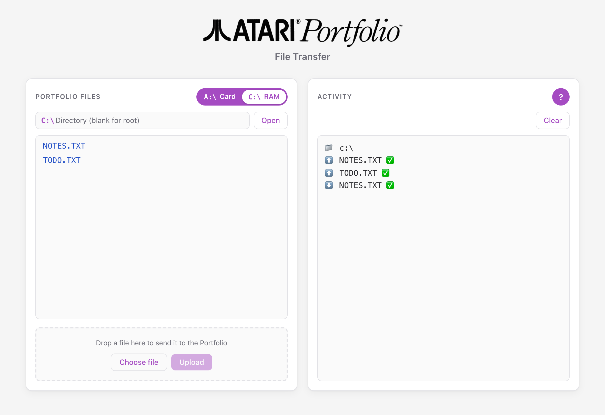
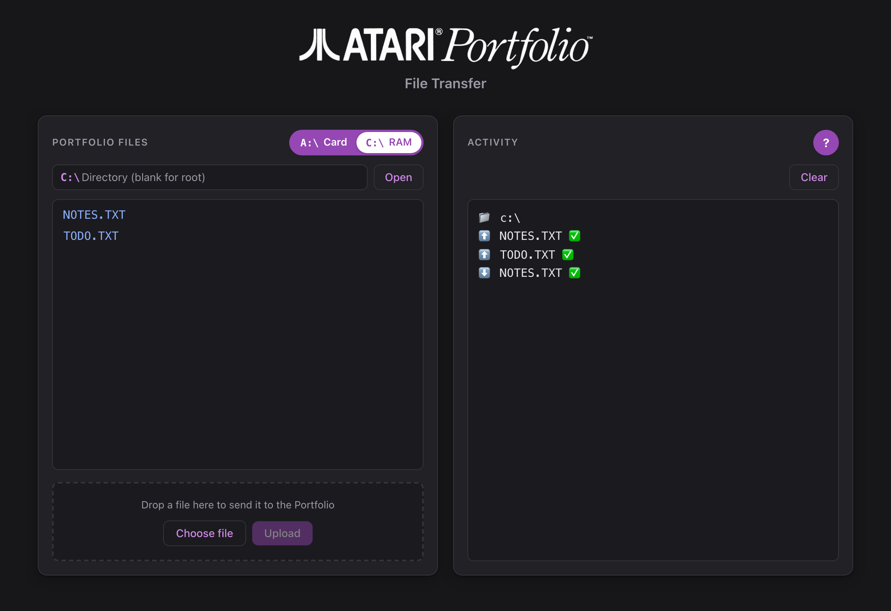
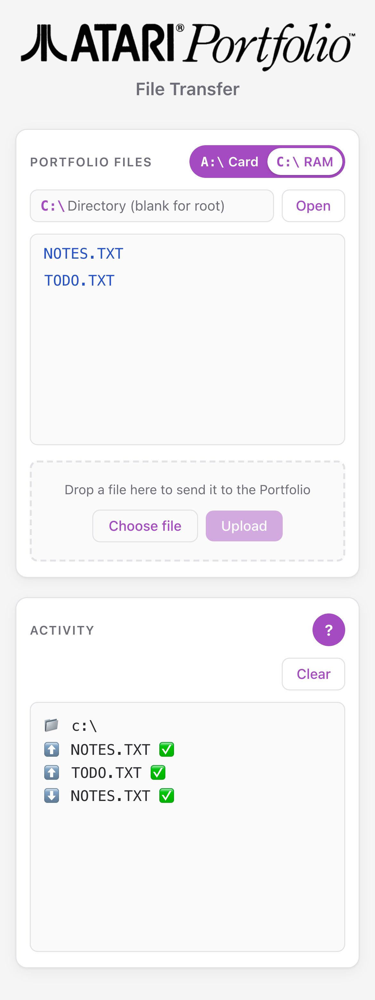
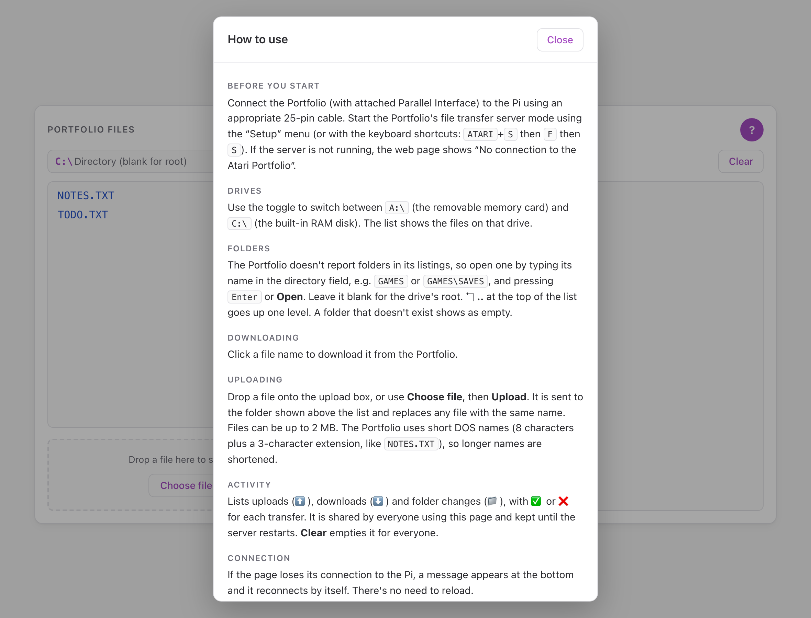

# PiPortfolioDaemon

**A web interface for moving files to and from an [Atari Portfolio](https://en.wikipedia.org/wiki/Atari_Portfolio), running on a Raspberry Pi.**

Connect a Raspberry Pi to the Portfolio's Parallel Interface, then browse, download and upload files from any browser on your network — desktop or phone.

<p align="center">
  
</p>

| | |
|---|---|
| **Original author** | [Lennart Hennigs](https://www.lennarthennigs.de) — created PiPortfolioDaemon in 2023 ([original repository](https://github.com/LennartHennigs/PiPortfolioDaemon)) |
| **Maintained by** | [James Adams](https://github.com/FutureJames) — this fork, with a redesigned interface, folder navigation, a systemd service and security fixes |
| **License** | [MIT](LICENSE) — Copyright © 2023 Lennart Hennigs |
| **Changes** | [Changelog](CHANGELOG.md) |

If you find this project useful, please consider giving the [original repository](https://github.com/LennartHennigs/PiPortfolioDaemon) a ⭐️ and/or [buying Lennart a ☕️](https://ko-fi.com/lennart0815).

---

## Contents

- [Why](#why)
- [Features](#features)
- [Screenshots](#screenshots)
- [What you need](#what-you-need)
- [Setup](#setup)
- [Using the web interface](#using-the-web-interface)
- [Managing the server](#managing-the-server)
- [Configuration](#configuration)
- [Troubleshooting](#troubleshooting)
- [Credits](#credits)

---

## Why

The Atari Portfolio was the first palmtop computer. Using one today is hard, because getting files onto it is hard:

- Its storage cards ([Bee Cards](https://en.wikipedia.org/wiki/Bee_Card_(game_cartridge))) are no longer made and are rare.
- File transfer needs the [Atari Portfolio Parallel Interface](https://www.atari-computermuseum.de/hpc_peri.htm)…
- …a computer that still has a parallel port…
- …and a transfer program such as [transfolio](http://www.pofowiki.de/doku.php?id=software:vorstellung:exchanges:transfolio).

Without these, a Portfolio is mostly a pretty plastic brick. PiPortfolioDaemon replaces the old PC with a Raspberry Pi and a web page, so any modern computer or phone can transfer files.

## Features

- **Browse both drives** — switch between `A:\` (memory card) and `C:\` (RAM disk), open folders by name and go back up with `..`
- **Download** a file with one click
- **Upload** by dropping a file onto the page, or by copying it into the Pi's `upload/` folder (for example over a SAMBA share)
- **Activity log** of uploads, downloads and folder changes, shared by everyone using the page
- **Built-in help** — the **?** button explains each part of the page
- **Recovers by itself** — reconnects after the Pi restarts or the network drops, and reports when the Portfolio isn't answering
- **Works anywhere** — responsive layout for phones, follows the system light/dark mode
- **Runs as a service** — starts when the Pi boots and restarts automatically if it stops

## Screenshots

<p align="center">
  
  &nbsp;
  
</p>

<p align="center">
  
</p>

---

## What you need

| | |
|---|---|
| **Atari Portfolio** | with the **Parallel Interface** attached |
| **Raspberry Pi** | tested on a Raspberry Pi Zero W; any model with the 40-pin GPIO header should work |
| **Cable / adapter** | a way to connect the Pi's GPIO pins to the Parallel Interface's 25-pin port — see [Wiring](#wiring) |
| **SD card** | with Raspberry Pi OS |

### Wiring

The Pi talks to the Portfolio over five wires. Connect the Pi's GPIO header to the Parallel Interface's 25-pin (DB25) port like this:

| Raspberry Pi (physical pin) | | Portfolio DB25 pin |
|---|:---:|---|
| Pin 7 | → | Pin 3 (data bit 1) |
| Pin 9 (GND) | — | Pins 18–25 (GND) |
| Pin 11 | → | Pin 2 (data bit 0) |
| Pin 13 | ← | Pin 12 (paper out) |
| Pin 15 | ← | Pin 13 (select) |

You can wire this with a DB25 breakout board, or use a small adapter board between the Pi's header and a 25-pin cable. Lennart's article [How to connect an Atari Portfolio](https://lennarthennigs.de/how-to-connect-an-atari-portfolio/) covers the hardware in more detail.

<p align="center">
  
</p>
<p align="center">
  
</p>

---

## Setup

These steps were tested on a **Raspberry Pi Zero W** running **Raspberry Pi OS 13 ("trixie")**. All commands run on the Pi, as your normal user (the examples use `atari`).

### 1. Prepare the Pi

Install Raspberry Pi OS with the [Raspberry Pi Imager](https://www.raspberrypi.com/software/). In the Imager's settings, set a **hostname** (e.g. `atari`), your **user name and password**, your **Wi-Fi**, and enable **SSH**. Then boot the Pi, connect with `ssh atari@atari.local`, and update it:

```bash
sudo apt update && sudo apt full-upgrade -y
```

### 2. Install the build tools and Node.js

```bash
sudo apt install -y git build-essential nodejs npm
```

Node.js 20 or newer is recommended (`node -v`).

### 3. Install WiringPi

`rpfolio` uses the WiringPi library to drive the GPIO pins. It is no longer in Raspberry Pi OS's package list, so build it from source:

```bash
cd ~
git clone https://github.com/WiringPi/WiringPi.git
cd WiringPi
./build debian
mv debian-template/wiringpi_*.deb .
sudo apt install -y ./wiringpi_*.deb
gpio -v        # should print the WiringPi version
```

### 4. Build and install `rpfolio`

`rpfolio` is the Raspberry Pi build of **transfolio**, the program that talks to the Portfolio.

```bash
cd ~
git clone https://github.com/skudi/transfolio.git
cd transfolio
cc -DRASPIWIRING -O3 transfolio.c -o rpfolio -lwiringPi
sudo install -m 755 rpfolio /usr/local/bin/rpfolio
```

> **Note:** this compiles directly instead of using `make rpfolio`. The Makefile lists `-lwiringPi` before the source file, which current compilers reject with "undefined reference" errors. The library has to come last, as above.

### 5. Test the connection

On the Portfolio, start the file transfer **server mode** from the **Setup** menu, or press **Atari + S**, then **F**, then **S**. Then, on the Pi:

```bash
rpfolio -l 'C:\*.*'
```

You should see a list of the files on the Portfolio's `C:` drive. If it waits at "Waiting for Portfolio…", check the wiring and that the Portfolio is in server mode.

### 6. Install PiPortfolioDaemon

```bash
cd ~
git clone https://github.com/FutureJames/PiPortfolioDaemon.git
cd PiPortfolioDaemon
npm install
```

### 7. Allow the web server to use port 80

The web page is served on port 80, so you can open it without adding a port number. Linux normally reserves ports below 1024 for root; this lets a normal user use port 80 (it stays set after a reboot):

```bash
echo 'net.ipv4.ip_unprivileged_port_start=80' | sudo tee /etc/sysctl.d/99-port80.conf
sudo sysctl --system
```

> Prefer not to change this? Use a higher port instead — see [Configuration](#configuration).

### 8. Run it as a service

This starts the server now, at every boot, and restarts it automatically if it stops:

```bash
sudo cp ~/PiPortfolioDaemon/piportfolio.service /etc/systemd/system/
sudo systemctl daemon-reload
sudo systemctl enable --now piportfolio
```

The service file assumes the user `atari` and the project in `/home/atari/PiPortfolioDaemon`. If yours differ, edit `User`, `Group` and `WorkingDirectory` in `/etc/systemd/system/piportfolio.service` first.

### 9. Open the web page

On any device on the same network, open:

```
http://atari.local/
```

(use your Pi's hostname, or its IP address). Put the Portfolio in server mode and start transferring.

### Optional: share the upload folder

Anything copied into `~/PiPortfolioDaemon/upload/` is sent to the Portfolio automatically and then removed. To drop files there from another computer, [share that folder over SAMBA](https://pimylifeup.com/raspberry-pi-samba/).

---

## Using the web interface

Click the **?** button on the page for the same instructions.

**Before you start** — connect the Portfolio and start its file transfer server mode (**Setup** menu, or **Atari + S**, **F**, **S**). If it isn't listening, the page shows *"No connection to the Atari Portfolio"*.

**Drives** — the toggle switches between `A:\` (the removable memory card) and `C:\` (the built-in RAM disk). The list shows the files on that drive.

**Folders** — the Portfolio doesn't report folders in its file listings, so open one by typing its name in the directory field (for example `GAMES` or `GAMES\SAVES`) and pressing **Enter** or **Open**. Leave it blank for the drive's root. **↰ ..** at the top of the list goes up one level. A folder that doesn't exist shows as empty.

**Downloading** — click a file name.

**Uploading** — drop a file onto the upload box, or use **Choose file**, then **Upload**. It goes to the folder shown above the list and replaces any file with the same name. Files can be up to 2 MB. The Portfolio uses short DOS names (8 characters plus a 3-character extension, like `NOTES.TXT`), so longer names are shortened.

**Activity** — lists uploads (⬆️), downloads (⬇️) and folder changes (📁), with ✅ or ❌ for each transfer. It is shared by everyone using the page and kept until the server restarts. **Clear** empties it for everyone.

**Connection** — if the page loses its connection to the Pi, a message appears at the bottom and it reconnects by itself.

---

## Managing the server

| Task | Command |
|---|---|
| Check that it's running | `systemctl status piportfolio` |
| Follow the server log | `journalctl -u piportfolio -f` |
| Restart (e.g. after changing the code) | `sudo systemctl restart piportfolio` |
| Stop / start | `sudo systemctl stop piportfolio` / `sudo systemctl start piportfolio` |
| Update to the latest version | `cd ~/PiPortfolioDaemon && git pull && npm install && sudo systemctl restart piportfolio` |

The log shows each page load, folder change and transfer:

```
Portfolio Folder Daemon v1.0 - LH 05/2023
-> c:\

- web page was loaded
- setting Portfolio folder: c:\
- uploading NOTES.TXT to Portfolio ✅
- uploading TODO.TXT to Portfolio ✅
- downloading NOTES.TXT from Portfolio ✅
```

**Running it by hand** (for development): stop the service first, since only one copy can use the port, then run `npm start` in the project folder. Start the service again when you're done.

## Configuration

Settings are in [`src/config/index.js`](src/config/index.js):

| Setting | Default | Purpose |
|---|---|---|
| `appPort` | `80` | Web server port. The `PORT` environment variable overrides it |
| `portfolioPath` | `c:\` | Drive/folder shown when the server starts. A command-line argument overrides it (`node server.js a:\`) |
| `sharedFolder` | `upload/` | Folder watched for files to send to the Portfolio |
| `portfolioTimeout` | `4000` | How long (ms) to wait for the Portfolio when listing or downloading |

To use another port with the service, add a line under `[Service]` in `/etc/systemd/system/piportfolio.service`, for example `Environment=PORT=3000`, then run `sudo systemctl daemon-reload && sudo systemctl restart piportfolio`.

## Troubleshooting

**"No connection to the Atari Portfolio"**
The Portfolio isn't answering. Check that it's switched on and in server mode — it turns itself off after a while, which also ends server mode. Then check the cable. `rpfolio -l 'C:\*.*'` on the Pi tests the connection directly.

**The page says it is reconnecting**
The page can't reach the server. Check that the Pi is on and that the service is running: `systemctl status piportfolio`.

**The service fails with `EACCES` on port 80**
The port 80 setting from [step 7](#7-allow-the-web-server-to-use-port-80) is missing. Apply it, or use another port.

**A transfer seems to hang**
While a file transfer is running, the server can't answer anything else, so the page waits until it finishes. If the Portfolio isn't in server mode, a transfer waits for it — put the Portfolio into server mode and it will continue.

**No icon in Safari's tab**
Safari doesn't load site icons for pages opened by IP address. Open the page by hostname instead (e.g. `http://atari.local/`).

---

## Credits

- **[Lennart Hennigs](https://www.lennarthennigs.de)** — original author of PiPortfolioDaemon
- **[James Adams](https://github.com/FutureJames)** — maintainer of this fork
- **Klaus Peichl** — [transfolio](http://www.pofowiki.de/doku.php?id=software:vorstellung:exchanges:transfolio), the Portfolio file transfer program
- **[skudi](https://github.com/skudi/transfolio)** — the Raspberry Pi port of transfolio (`rpfolio`)
- **[WiringPi](https://github.com/WiringPi/WiringPi)** — GPIO library used by `rpfolio`

Released under the [MIT license](LICENSE). Copyright © 2023 Lennart Hennigs.
